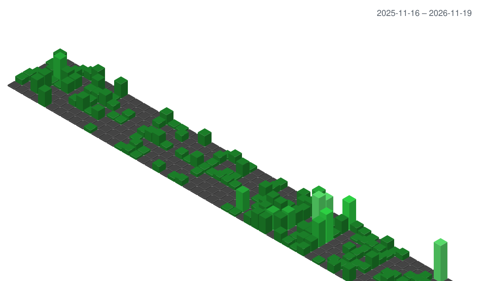

# Kent Brought 

MIT '26 · San Francisco

**Portfolio:** https://kentbrought.github.io/  
**MIT GitHub Enterprise instance:** https://github.mit.edu/kbrought

[LinkedIn](https://www.linkedin.com/in/kent-brought)

Some of my work is private or on the MIT GitHub Enterprise instance.

### Tools

### GitHub Stats

<picture>
  <source media="(prefers-color-scheme: dark)" srcset="https://github-readme-stats-eta-gold.vercel.app/api?username=KentBrought&include_all_commits=true&show_icons=true&hide_rank=true&hide=stars,issues,contribs&show=prs_merged&theme=transparent&hide_border=true&hide_title=true&card_width=420&line_height=26&bg_color=00000000&text_color=c9d1d9&icon_color=58a6ff" />
  
</picture>

### Most Used Languages

### Contribution Skyline

